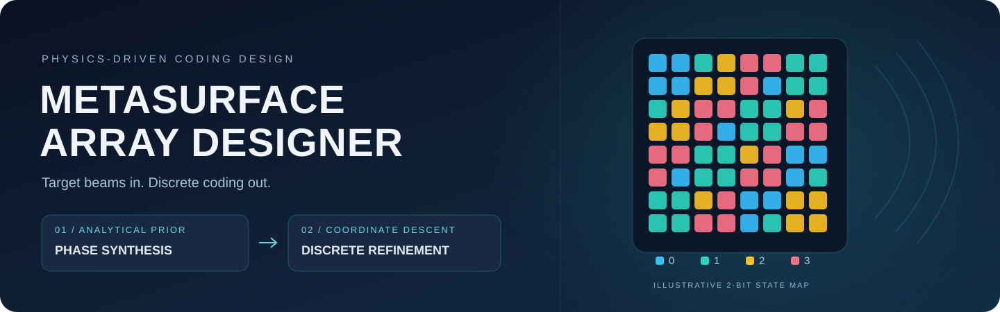

<div align="center">



# 超表面阵列编码设计系统

**从目标波束到离散编码，让阵列设计更直观。**

解析初始化 · 增量坐标下降 · 多波束设计 · OAM 模式 · Python / MATLAB

[](#-快速开始)
[](python/metasurface_designer.py)
[](#-功能一览)
[](matlab/)
[](LICENSE)

[快速开始](#-快速开始) · [工作原理](#-工作原理) · [命令行](#-命令行与脚本) · [项目结构](#-项目结构)

</div>

---

## ✨ 功能一览

输入**工作频率、单元周期、阵列尺寸和目标波束角度**，生成 1-bit / 2-bit 超表面整数编码矩阵。适合解析设计、优化方法对照和编码文件导出。

| 🎯 波束配置 | 🧩 离散编码 | 🖥️ 图形交互 |
| --- | --- | --- |
| 单波束、多波束与非对称目标角度 | 1-bit 两状态、2-bit 四状态 | 参数输入、矩阵预览、状态分布与文件导出 |
| **⚡ 两阶段优化** | **🔬 方法对照** | **📦 双语言工具** |
| 解析初值＋增量坐标下降 | 解析综合、局部搜索与遗传算法 | Python GUI / CLI，MATLAB 求解器与界面 |

### 一次设计需要什么？

| 输入 | 示例 | 说明 |
| --- | --- | --- |
| 工作频率 | `1.7 THz` | 决定波长与阵元间相位差 |
| 单元周期 | `70 μm` | 相邻阵元的物理间距 |
| 阵列规模 | `36 × 36` | CLI 可分别指定行数和列数 |
| 编码位数 | `2-bit` | 对应四种离散相位状态 |
| 目标波束 | `(30°, 150°)`、`(40°, 300°)` | 每束由俯仰角与方位角确定 |
| 可选权重 | `1 1` | 目标方向的复场幅度权重 |

**输出：** 编码矩阵、求解耗时、目标函数值和评价次数；可导出为 TXT、CSV 或 MAT 文件。

**OAM 涡旋波模式：** Python 界面支持2-bit、目标阶数 `±1` / `±2`，提供强度、相位及两个观察圆盘的模式谱诊断。采用解析初始化和坐标下降；模式占比不等于辐射效率，环上绕转不能保证高阶奇点未分裂。[使用范围与方法 →](docs/涡旋波模式.md)

### 一个项目，两种设计模式

| 模式 | 功能入口 | 支持范围 |
| --- | --- | --- |
| 普通波束赋形 | 界面选择“普通波束”，或 `--beam-type plane` | 1/2-bit、单波束与多波束，Python / MATLAB |
| OAM 涡旋波 | 界面选择“涡旋波 (OAM)”，或 `--beam-type vortex` | 2-bit、法线目标轴、阶数±1/±2，Python |

两种模式共用项目入口，分别使用与目标相符的优化公式和结果指标。

当前版本的两阶段优化不包含深度学习；OAM 功能采用理想标量模型，用于排布设计和初步筛选。

## 🚀 快速开始

### ① 安装依赖

下载或克隆仓库后，在项目根目录打开终端：

```bash
pip install -r requirements.txt
```

使用带 Tkinter 的 Python 环境。建议创建虚拟环境，以便独立管理依赖。

### ② 启动界面

**Windows：双击根目录的 `启动设计系统.bat`。**

也可以直接运行：

```bash
python python/app_gui.py
```

启动脚本优先使用项目的 `.venv`，随后查找本机 Python 安装或 `py` / `python` 命令；启动失败时保留错误信息供排查。

### ③ 配置与导出

选择频率、周期、阵列规模和编码位数，填写各目标波束的角度，然后点击 **「立即生成编码矩阵」**。

- 默认选择 `fast`，先生成解析初值，再做离散局部微调。
- 界面显示编码矩阵及各状态的数量和占比。
- 生成文件默认放在项目根目录下的 `output/`，也可自行选择保存位置。

## 🧠 工作原理

系统采用**解析初始化＋离散坐标下降**。解析步骤确定基本相位分布，局部搜索在合法离散状态之间进行微调。下面的流程和公式适用于普通波束；OAM 使用[独立的模式能量与泄漏目标](docs/涡旋波模式.md#解析相位与优化目标)。


**第一阶段：算出初始排布。** 根据波束方向构造阵面复场 $W_{mn}$，取相角并量化到合法编码。1-bit 对应 $0^\circ/180^\circ$，2-bit 对应 $0^\circ/90^\circ/180^\circ/270^\circ$。

**第二阶段：尝试局部改进。** 每次只改变一个阵元，通过更新它对总复场的贡献来评价新状态，避免反复计算整个阵面。默认最多遍历三轮，没有改进时提前停止。

普通波束求解器的目标函数为：

$$
J=\left|\sum_{m,n}e^{-j\Phi_{mn}}W_{mn}\right|,
\qquad \mathrm{fitness}=-J.
$$

`fitness` 越小，表示该目标下的相干合成幅值越大。[查看完整推导与增量更新公式 →](docs/算法原理.md)

## ⚙️ 求解模式

| 模式 | 初始化与搜索方式 | 适用场景 |
| --- | --- | --- |
| **`fast` · 默认** | 解析初值＋增量坐标下降 | 常规编码设计 |
| `analytical` | 相位叠加后直接量化 | 快速查看解析结果 |
| `greedy` | 随机初值＋坐标下降 | 研究初始值影响，通过 Python / CLI 调用 |
| `ga_exact` | 种群选择、交叉、变异和精英筛选 | 传统优化方法对照 |

OAM 模式目前仅支持 `fast` 和 `analytical`，要求16到64之间的偶数方阵、2-bit、单元周期不超过半波长且阵面边长至少4个波长；MATLAB 工具目前只提供普通波束设计。

## 💻 命令行与脚本

### 生成双波束编码

在项目根目录运行，生成 1.7 THz、70 μm 周期、36×36 阵面的 2-bit 编码矩阵：

```bash
python python/metasurface_designer.py --freq 1.7 --period 70 --theta 30 40 --phi 150 300 --N 36 --bit 2 --method fast --output output/my_matrix.txt
```

| 参数 | 含义 |
| --- | --- |
| `--freq` / `--period` | 频率（THz）/ 周期（μm） |
| `--theta` / `--phi` | 俯仰角 / 方位角列表，按位置配对，单位为度 |
| `--N` / `--M` | 列数 / 行数；省略 `--M` 时使用方阵 |
| `--bit` | `1` 或 `2` |
| `--weights` | 可选幅度权重列表，不直接等于最终波束功率比例 |
| `--method` / `--output` | 求解模式 / 输出路径 |
| `--beam-type` / `--oam-charge` | `plane` 普通波束或 `vortex` 涡旋波；OAM 目标阶数为 `-2/-1/1/2` |

### 生成 OAM 编码

```bash
python python/metasurface_designer.py --beam-type vortex --oam-charge 1 --freq 1.7 --period 70 --N 36 --bit 2 --method fast --output output/oam_l1.txt
```

省略角度时自动使用法线方向作为目标轴。编码矩阵旁会保存 `_oam.json` 指标、`_oam.npz` 复场与完整模式谱、`_oam.png` 诊断图。界面和 JSON 同时提供局部圆盘及 `R=0.99` 圆盘的模式占比，二者均不代表总辐射效率。

### MATLAB 调用

进入 `matlab/` 目录运行 `metasurface_gui`，或调用求解器：

```matlab
[matrix, fitness, elapsed] = metasurface_fast( ...
    'fre', 1.7e12, 'D', 70e-6, 'theta', [30 40], ...
    'phi', [150 300], 'N', 36, 'nbit', 2);
```

MATLAB 接口的频率单位为 **Hz**，周期单位为 **m**。

## 📁 项目结构

```text
.
├── 启动设计系统.bat          # Windows 唯一双击启动入口
├── README.md                 # 项目展示与快速开始
├── requirements.txt          # Python 依赖
├── LICENSE
├── python/                   # 全部 Python 源码
│   ├── app_gui.py            # 图形界面
│   ├── metasurface_designer.py # GUI 与 CLI 共用的求解器
│   ├── oam.py                # OAM 合成、复场和模式谱评价
│   ├── oam_view.py           # 强度、相位与模式谱诊断视图
│   ├── verify_pipeline.py    # 生成与导出校验
│   ├── tests/                # OAM 与普通波束回归检查
│   └── benchmarks/           # 基准与矩阵比较脚本
├── matlab/                   # MATLAB 求解器、界面和绘图脚本
└── docs/                     # 详细原理、使用说明与展示素材
```

`output/` 和 `reports/` 在运行时生成，不纳入版本控制。仓库不附带三个示例矩阵；比较脚本需要自行准备相同物理条件下的输入。

<details>
<summary><b>📐 模型与评价说明</b></summary>

当前使用理想等幅、离散相位的阵列因子模型。普通波束优化目标是目标方向复场的加权相干和幅值；各束实际功率、指向误差和非目标杂散峰需要结合方向图另行评价。OAM 使用指定圆盘内的目标模式能量、其他模式泄漏及轴心场惩罚，环上绕转表示环内总拓扑荷；严格居中或未分裂的高阶奇点需要额外约束和验证。

局部搜索会随机打乱阵元访问顺序，结果可能略有变化；Python 与 MATLAB 的随机序列和边界量化规则也可能不同。求解耗时随硬件、阵列规模和搜索预算变化。

</details>

---

<div align="center">

**配置波束 · 生成编码 · 导出矩阵**

[详细原理](docs/算法原理.md) · [使用说明](docs/使用说明.txt) · [MIT License](LICENSE)

</div>
